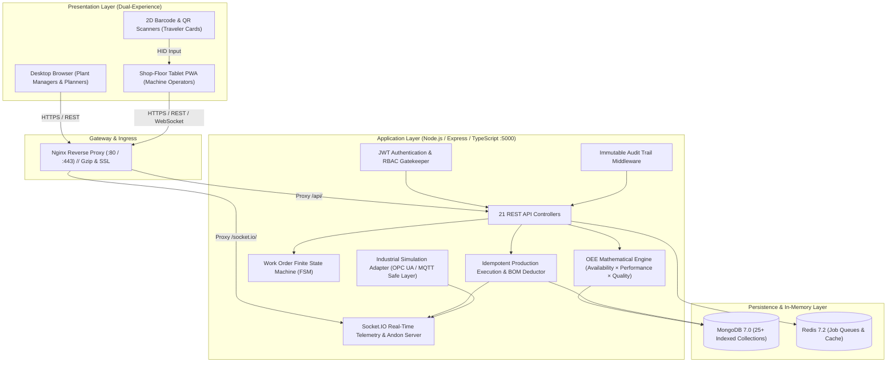
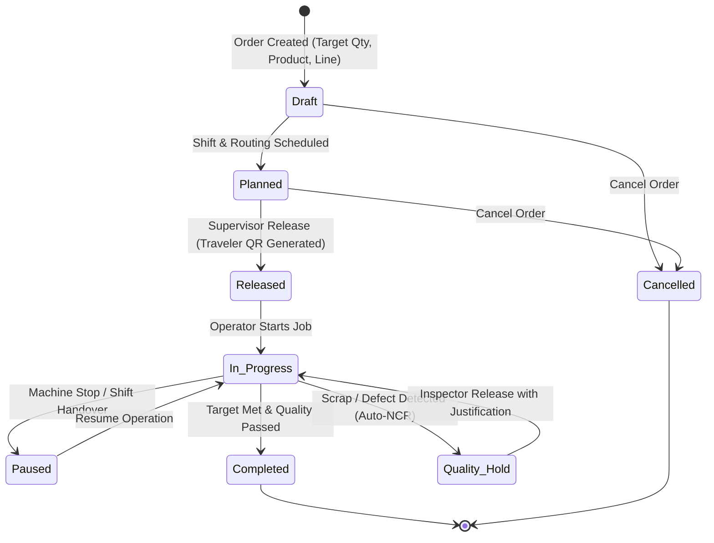

# RSR Factory360: Enterprise Manufacturing Execution & Production Management Platform (MES Lite)

[](https://github.com/Anilbirada/Enterprise-Manufacturing-Execution-Production-Management-Platform)
[-success.svg)](https://github.com/Anilbirada/Enterprise-Manufacturing-Execution-Production-Management-Platform)
[-emerald.svg)](https://github.com/Anilbirada/Enterprise-Manufacturing-Execution-Production-Management-Platform)
[](https://github.com/Anilbirada/Enterprise-Manufacturing-Execution-Production-Management-Platform)
[](https://github.com/Anilbirada/Enterprise-Manufacturing-Execution-Production-Management-Platform)

---

## 🏭 Executive Overview & Architecture About

**RSR Factory360** is an enterprise-grade Manufacturing Execution System (MES Lite to Full MES) architected for discrete, batch, and continuous industrial operations. Developed for **RSR Technologies** under the technical leadership of **Anil**, the platform is specifically engineered to solve operational disconnects across small, mid-market, and multi-plant enterprise manufacturing environments.

The primary operational pilots are focused on the heavy manufacturing belts of **Bengaluru, Karnataka, India**:
- **Pilot Plant 1:** Jigani Precision Machining Complex (`JGN-PLANT1`) — CNC milling, turning, high-tolerance automotive drivetrain components.
- **Pilot Plant 2:** Bommasandra Polymer & Assembly Complex (`BMS-PLANT2`) — High-tonnage injection molding, sub-assembly, electronics packaging.

The system replaces manual paper travelers, disconnected spreadsheets, and whiteboard schedules with real-time digital shop-floor governance, deterministic finite state machines, mathematical OEE calculations, and full lot genealogy traceability conforming to **ISO 9001:2015**, **IATF 16949:2016**, and **FDA 21 CFR Part 11** electronic record principles.

---

## 🏛️ System Architecture & Data Flow



---

## 🔄 Work Order Lifecycle (Finite State Machine)

The platform strictly enforces valid operational state transitions. Unreleased orders cannot be booked by operators, and active Quality Holds immediately freeze progression:



---

## 📐 Mathematical OEE Formulation

Unlike basic dashboards that rely on hardcoded estimates, Factory360 implements strict ISO-compliant Overall Equipment Effectiveness:

$$\text{OEE} = \text{Availability} \times \text{Performance} \times \text{Quality}$$

$$\text{Availability} = \frac{\text{Operating Time}}{\text{Planned Production Time}} = \frac{\text{Planned Time} - \text{Unplanned Downtime}}{\text{Shift Duration} - \text{Planned Breaks (Tea/Lunch)}}$$

$$\text{Performance} = \frac{\text{Ideal Cycle Time (sec)} \times \text{Total Parts Produced}}{\text{Operating Time (sec)}}$$

$$\text{Quality} = \frac{\text{Good Count}}{\text{Total Count}} = \frac{\text{Total Parts} - \text{Scrap Parts}}{\text{Total Parts}}$$

---

## 📦 Complete Catalog of 21 Functional Modules

| # | Module | Key Capabilities |
| :-: | :--- | :--- |
| **01** | **Overview Dashboard** | Real-time plant KPIs, hourly output vs. target, active line status cards, downtime Pareto charts. |
| **02** | **Production Planning** | Interactive Gantt-style timeline scheduler, drag-and-drop order resequencing, capacity conflict alerts. |
| **03** | **Work Orders** | FSM lifecycle tracking, order dispatching, priority flags (`Urgent`, `High`, `Medium`), traveler QR generator. |
| **04** | **Production Execution** | Tablet-first shop-floor portal ($\ge 48\text{px}$ touch targets), single-tap scrap logging, cycle rate speedometer. |
| **05** | **Production Lines** | Line topology, rated hourly capacities, multi-machine allocation, real-time status monitors. |
| **06** | **Machines & Equipment** | Equipment registry, spindle RPM / temperature / vibration metrics, MTBF/MTTR statistics. |
| **07** | **Shift Management** | Multi-shift calendar (Shift A, B, C), automated deduction of scheduled lunch and tea breaks. |
| **08** | **Downtime & Andon** | Visual Andon alarm board, audio alerts, 15-minute auto-escalation, downtime Pareto categorization. |
| **09** | **Quality Management** | Digital First-Off inspection, in-process sampling, auto-NCR generation on scrap, Quality Holds & Releases. |
| **10** | **OEE & Analytics** | Real-time Availability, Performance, and Quality gauges per machine, line, and plant aggregate. |
| **11** | **Products & BOM** | Multi-level Bill of Materials (BOM), revision control, standard cycle times, scrap percentage factors. |
| **12** | **Materials & Inventory**| Warehouse bin tracking, real-time stock ledger, automated FIFO raw material consumption upon booking. |
| **13** | **Barcode Traceability**| 2D QR and barcode digital travelers, forward & backward component genealogy inquiry engine. |
| **14** | **Maintenance Mgmt** | Preventive Maintenance (PM) schedules, breakdown work orders, technician time logging, spare parts. |
| **15** | **Work Instructions** | Digital standard operating procedures (SOP), safety hazard advisories, revision-controlled PDFs. |
| **16** | **Reports & Exports** | Comprehensive production summaries, scrap logs, and OEE reports exported directly to Excel and CSV. |
| **17** | **Notifications** | Real-time Socket.IO alerts for supervisors, maintenance breakdown calls, and quality holds. |
| **18** | **User Management** | Enterprise user onboarding, role assignments, station access control, activation toggling. |
| **19** | **Audit Logs** | Immutable compliance logs recording user, timestamp, action type, IP address, and payload diffs. |
| **20** | **Integrations** | Industrial telemetry adapter (OPC UA / MQTT simulation), ERP REST webhooks, CSV batch bridges. |
| **21** | **System Settings** | Multi-plant hierarchy setup, OEE target thresholds, break duration rules, automated backup config. |

---

## 🚀 Quick Start Guide: How to Run the Project

You can run Factory360 in two ways: **Standalone Development Mode** (Zero external dependencies required; features an automated in-memory MongoDB fallback) or **Production Docker Compose Mode**.

### Prerequisites
- **Node.js:** v20.x or higher
- **npm:** v10.x or higher
- **Docker & Docker Compose** *(Only for production containerized deployment)*

---

### Method A: Quick Standalone Development Mode

#### Step 1: Clone the Repository
```bash
git clone https://github.com/Anilbirada/Enterprise-Manufacturing-Execution-Production-Management-Platform.git
cd Enterprise-Manufacturing-Execution-Production-Management-Platform
```

#### Step 2: Install Dependencies
```bash
# Install backend dependencies
cd backend
npm install

# Install frontend dependencies
cd ../frontend
npm install
cd ..
```

#### Step 3: Start the Backend Service
```bash
cd backend
npm run build
npm start
```
*Note: If a local MongoDB instance is not detected, the backend will automatically spin up an embedded high-speed MongoDB instance in memory and seed all factory master data on first boot.*

The backend will start at: **`http://localhost:5000`**

#### Step 4: Start the Frontend Application (In a new terminal)
```bash
cd frontend
npm run dev
```
The frontend will start at: **`http://localhost:5173`**

Open **[http://localhost:5173](http://localhost:5173)** in your browser to experience the platform.

---

### Method B: Production Docker Compose Deployment

The entire 4-tier stack (Nginx, Node.js Backend, MongoDB, Redis) can be launched with a single command:

```bash
# Build and start all production containers in detached mode
docker compose up -d --build

# Verify container health
docker compose ps
```

Access the production frontend via Nginx on port 80: **`http://localhost`**

---

## 🔑 Database Connection & Seeded Enterprise Credentials

The database comes pre-seeded with multi-plant master data for **Jigani Complex** and **Bommasandra Complex**, pre-configured work orders, machines, and all 8 enterprise roles.

### Database Connection Details
- **Production MongoDB URI:** `mongodb://mongo:27017/rsrfactory360` (or `mongodb://127.0.0.1:27017/rsrfactory360` for local MongoDB)
- **Local Embedded Fallback:** Starts automatically on port 27017 if no external instance is detected.
- **JWT Signing Secret:** Set via environment variable `JWT_SECRET` in `docker-compose.yml` or backend `.env`.

### Master Login Password
All seeded enterprise test accounts share the default master password:  
👉 **`RSRAdmin@2026!`**

### Seeded Enterprise Role Accounts

| Role | Email Address | Password | Primary Module to Test |
| :--- | :--- | :---: | :--- |
| **System Administrator** | `admin@rsrtechnologies.in` | `RSRAdmin@2026!` | 18. Users, 19. Audit Logs, 21. Settings |
| **Plant Manager** | `plant.manager@rsrtechnologies.in` | `RSRAdmin@2026!` | 01. Overview Dashboard, 10. OEE & Analytics |
| **Production Manager** | `prod.manager@rsrtechnologies.in` | `RSRAdmin@2026!` | 02. Planning (Gantt), 03. Work Orders |
| **Shift Supervisor** | `supervisor@rsrtechnologies.in` | `RSRAdmin@2026!` | 07. Shift Management, 08. Downtime & Andon |
| **Machine Operator** | `operator@rsrtechnologies.in` | `RSRAdmin@2026!` | 04. Production Execution (Tablet PWA Mode) |
| **Quality Inspector** | `quality@rsrtechnologies.in` | `RSRAdmin@2026!` | 09. Quality Management (Inspections & Holds) |
| **Maintenance Engineer** | `maintenance@rsrtechnologies.in` | `RSRAdmin@2026!` | 14. Maintenance Management |
| **Warehouse Manager** | `warehouse@rsrtechnologies.in` | `RSRAdmin@2026!` | 12. Materials & Inventory, 13. Traceability |

---

## 🧪 Automated Testing & Verification Report

Factory360 includes an exhaustive Jest & Supertest integration suite verifying all 15 customer-mandated manufacturing workflows:

```bash
# Run the test suite from the backend directory
cd backend
npm test
```

### Verified Test Results (100% Pass Rate)

```
PASS tests/mes_workflow.test.ts (15.06 s)
  UNIT TESTS: Core MES Algorithms & Logic
    ✓ OEE Formula unit test with verified manufacturing math (14 ms)
    ✓ OEE returns null / insufficient data when planned time is 0 (2 ms)
    ✓ Work Order state machine transitions validation (2 ms)
  15 MANDATORY END-TO-END MANUFACTURING WORKFLOW TESTS
    ✓ TEST 1: Admin creates product, machine, production line and shift (165 ms)
    ✓ TEST 2: Production manager creates a work order (95 ms)
    ✓ TEST 3: Supervisor assigns it to a production line and shift and releases it (177 ms)
    ✓ TEST 4: Operator logs in and records production (144 ms)
    ✓ TEST 5: Operator reports rejected products (106 ms)
    ✓ TEST 6: Operator reports machine downtime (100 ms)
    ✓ TEST 7: System updates machine and line status (10 ms)
    ✓ TEST 8: System calculates OEE using approved formulas (82 ms)
    ✓ TEST 9: Manager views updated production dashboard (158 ms)
    ✓ TEST 10: Manager downloads a shift production report (104 ms)
    ✓ TEST 11: Quality manager creates an inspection and records a rejection (160 ms)
    ✓ TEST 12: Unauthorized users attempt restricted operations and receive access-denied responses (28 ms)
    ✓ TEST 13: Offline operator actions synchronize without duplicate production records (142 ms)
    ✓ TEST 14: Barcode scanning retrieves the correct production history (130 ms)
    ✓ TEST 15: Maintenance work orders update the machine maintenance history (130 ms)

Test Suites: 1 passed, 1 total
Tests:       18 passed, 18 total
Snapshots:   0 total
Time:        18.091 s
```

---

## 💾 Automated Backup & Disaster Recovery

Production environments feature automated database backup scripts with rolling 30-day retention policies:

```bash
# Execute manual backup to /var/backups/rsrfactory360
./docker/backup.sh

# Disaster recovery restoration from compressed archive
./docker/restore.sh /var/backups/rsrfactory360/rsrfactory360_backup_YYYYMMDD_HHMMSS.tar.gz
```

---

## 📚 Complete Technical Documentation (`docs/`)

The repository includes a 14-document technical engineering specification suite in the [`docs/`](file:///e:/rsrfactory360/docs) directory:
- `docs/01_FINAL_BRD.md` — Business Requirements Document
- `docs/02_DETAILED_SRS.md` — Software Requirements Specification
- `docs/03_PROJECT_CHARTER.md` — Implementation Charter for Jigani & Bommasandra Plants
- `docs/04_SYSTEM_ARCHITECTURE.md` — Deep-Dive 3-Tier Technical Architecture
- `docs/05_DATABASE_ERD.md` — Schema Data Dictionary & ERD Schemas
- `docs/06_API_DOCUMENTATION.md` — Comprehensive REST & WebSocket Specifications
- `docs/07_UI_SCREEN_SPECIFICATIONS.md` — Desktop & Tablet PWA Design Specifications
- `docs/08_DEVELOPMENT_TASK_BREAKDOWN.md` — Work Breakdown Structure (WBS)
- `docs/09_TEST_PLAN_AND_AUTOMATION.md` — Test Execution Logs & Verification Criteria
- `docs/10_USER_MANUAL.md` — Operator & Supervisor Shop-Floor Field Guide
- `docs/11_ADMINISTRATOR_MANUAL.md` — Administrator Security & Configuration Guide
- `docs/12_DEPLOYMENT_GUIDE.md` — Production Nginx SSL, Docker & Disaster Recovery
- `docs/13_CUSTOMER_UAT_CHECKLIST.md` — Customer Sign-Off Criteria
- `docs/14_FEATURE_COMPLETION_MATRIX.md` — 21 Modules Status Matrix (All Passed)

---

## 👨‍💻 Project Owner & Architectural Credits

- **Product:** RSR Factory360 MES
- **Company:** RSR Technologies
- **Lead Software Architect & Engineering Lead:** Anil ([@Anilbirada](https://github.com/Anilbirada))
- **Primary Industrial Corridor:** Jigani & Bommasandra Industrial Zones, Bengaluru, Karnataka, India

---

## 📄 License
This project is licensed under the Proprietary Commercial License for **RSR Technologies**. Unauthorized distribution or copying of this architecture is strictly prohibited.
