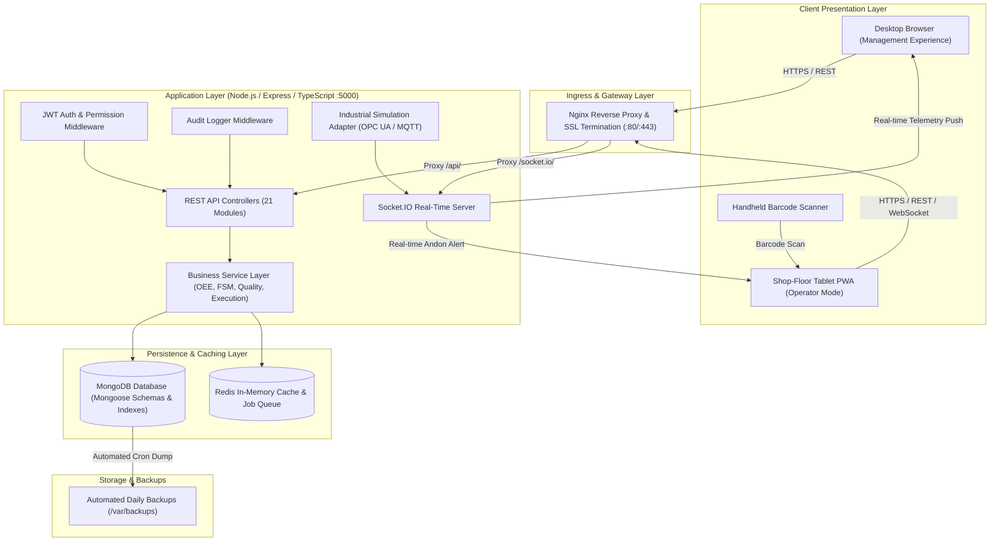

# SYSTEM ARCHITECTURE DOCUMENT
## RSR Factory360 MES Platform

---

### 1. High-Level Architectural Overview

RSR Factory360 follows an enterprise 3-tier microservice-ready architecture designed for low latency, high concurrency, and reliable shop-floor data capture.

---

### 2. Frontend Architecture (React + TypeScript + Vite)
- **State Management & Data Fetching:** `@tanstack/react-query` for declarative server state synchronization, query caching, and optimistic updates.
- **Styling & UI Components:** `Tailwind CSS` with custom industrial dark/light surfaces (`industrial-900`, `industrial-950`, `cyan-400`, `rose-600`, `amber-500`, `emerald-500`).
- **Data Visualization:** `Recharts` for interactive production trend lines, OEE gauge radial charts, and downtime Pareto distributions.
- **Offline Resilience:** Custom `ApiService` offline queue in `localStorage`. Captures operator POST/PUT requests during Wi-Fi dropouts and syncs automatically when connection is re-established.
- **Responsive Dual Layout:**
  - **Management Experience:** Dense data tables, filters, Gantt scheduling, audit logs, and analytics.
  - **Shop-Floor Experience:** High touch targets ($\ge 48\text{px}$), barcode scanner input focus, single-tap scrap logging, and prominent emergency Andon buttons.

---

### 3. Backend Architecture (Express + TypeScript)
- **Strict Layered Separation:**
  1. `routes/`: Routing definitions and middleware mounts.
  2. `middlewares/`: Authentication (`authenticateJWT`), RBAC enforcement (`requirePermission`), audit trail logger (`auditMiddleware`), centralized error handler (`errorHandler`).
  3. `controllers/`: HTTP payload validation, parameter extraction, and status code responses.
  4. `services/`: Encapsulated domain logic:
     - `workOrderService.ts`: FSM state transitions and validation.
     - `productionExecutionService.ts`: Idempotent booking, BOM auto-deduction, stock ledger logging.
     - `oeeService.ts`: Availability, Performance, Quality, and OEE aggregation.
     - `qualityService.ts`: Inspection results, auto-NCR creation, quality holds.
     - `traceabilityService.ts`: Forward/backward lot genealogies.
  5. `adapters/`: External protocol integration:
     - `industrialSimulationAdapter.ts`: OPC UA / MQTT simulation generating machine telemetry (spindle RPM, temperature, vibration) without dangerous writes to physical PLCs.
     - `notificationAdapter.ts`: Socket.IO room broadcasting based on `plantId`.
     - `erpAdapter.ts`: CSV and Excel data export and import processing.

---

### 4. Database Persistence Layer (MongoDB + Mongoose)
- **Multi-Plant Tenancy:** Every operational document carries a `plantId` reference indexed with query predicates for fast query execution.
- **Zero In-Memory Volatility:** In production, data persists in MongoDB container volumes (`mongo-data`). For zero-dependency standalone execution (testing or developer sandboxes), automatic fallback to `mongodb-memory-server` is supported.
- **Indexes:** Compound indexes on `(plantId, status)`, `(plantId, orderNumber)`, `(machineId, timestamp)`, and `(batchNumber)`.
