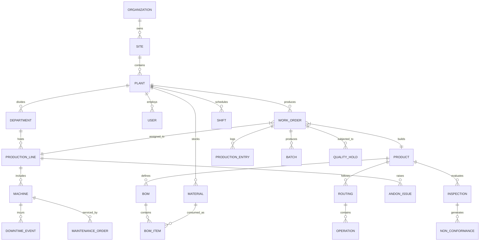

# DATABASE ENTITY-RELATIONSHIP DOCUMENTATION (ERD)
## RSR Factory360 MES Schemas

---

### 1. Entity-Relationship Diagram

---

### 2. Detailed Data Dictionary

#### 2.1 Users & Authentication (`users`)
- `_id`: ObjectId (Primary Key)
- `email`: String (Unique, Indexed)
- `name`: String
- `password`: String (Hashed with bcrypt)
- `role`: Enum (`System Administrator`, `Plant Manager`, `Production Manager`, `Shift Supervisor`, `Machine Operator`, `Quality Manager / Inspector`, `Maintenance Engineer`, `Warehouse Manager`)
- `plantId`: ObjectId (Ref: `plants`, Indexed)
- `permissions`: Array of Strings (e.g., `['workorders:create', 'execution:book']` or `['*']`)
- `status`: Enum (`Active`, `Inactive`, `Suspended`)
- `lastLogin`: Date

#### 2.2 Master Data: Hierarchy & Machines
- `organizations`: `code`, `name`, `headquarters`
- `sites`: `code`, `name`, `organizationId`, `region`
- `plants`: `code` (Unique), `name`, `siteId`, `location`, `active`
- `departments`: `code`, `name`, `plantId`, `costCenter`
- `production_lines`: `code` (Unique per plant), `name`, `plantId`, `departmentId`, `capacityPerHour`, `status`
- `machines`: `code` (Unique per plant), `name`, `plantId`, `productionLineId`, `type`, `status` (`Running`, `Idle`, `Downtime`, `Maintenance`, `Offline`), `standardCycleTimeSeconds`, `idealCycleTimeSeconds`, `serialNumber`, `installedAt`

#### 2.3 Master Data: Products, BOM & Routings
- `products`: `code` (Unique), `name`, `category`, `uom`, `standardCycleTimeSeconds`, `active`, `minimumStock`
- `materials`: `code` (Unique), `name`, `category`, `uom`, `currentStock`, `reorderLevel`, `unitCost`, `locationBin`
- `boms`: `productId`, `version`, `active`, `items`: Array of `{ materialId, quantity, uom, scrapPercentage }`
- `routings`: `productId`, `version`, `active`, `operations`: Array of `{ sequence, name, machineType, standardTimeSeconds, isQualityGate }`
- `shifts`: `code`, `name`, `startTime`, `endTime`, `durationMinutes`, `plannedBreakMinutes`, `breaks`: Array of `{ name, startTime, durationMinutes }`

#### 2.4 Production Planning & Orders (`work_orders`)
- `_id`: ObjectId
- `orderNumber`: String (Unique, Indexed)
- `plantId`: ObjectId (Ref: `plants`, Indexed)
- `productId`: ObjectId (Ref: `products`, Indexed)
- `productionLineId`: ObjectId (Ref: `production_lines`)
- `shiftId`: ObjectId (Ref: `shifts`)
- `plannedQuantity`: Number
- `completedQuantity`: Number
- `rejectedQuantity`: Number
- `reworkQuantity`: Number
- `priority`: Enum (`Low`, `Medium`, `High`, `Urgent`)
- `status`: Enum (`Draft`, `Planned`, `Released`, `In Progress`, `Paused`, `Completed`, `Cancelled`)
- `startDatePlanned`: Date
- `dueDate`: Date
- `isQualityHold`: Boolean (Indexed)
- `qualityHoldReason`: String

#### 2.5 Production Execution & Ledger (`production_entries`, `inventory_transactions`)
- `production_entries`: `workOrderId`, `plantId`, `productionLineId`, `machineId`, `shiftId`, `operatorId`, `operationSequence`, `goodQuantity`, `scrapQuantity`, `reworkQuantity`, `cycleTimeActualSeconds`, `recordedAt`
- `inventory_transactions`: `materialId`, `plantId`, `workOrderId`, `transactionType` (`Stock In`, `Stock Out`, `Adjustment`, `Scrap`), `quantity`, `referenceDocument`, `transactedBy`, `transactedAt`

#### 2.6 Quality Management (`inspections`, `non_conformances`, `quality_holds`)
- `inspections`: `inspectionNumber`, `plantId`, `productId`, `workOrderId`, `inspectionType`, `sampleSize`, `inspectedQuantity`, `passedQuantity`, `rejectedQuantity`, `disposition` (`Accepted`, `Rejected`, `Rework`, `Concession`), `defectReason`, `inspectorId`, `inspectedAt`
- `non_conformances`: `ncrNumber`, `plantId`, `inspectionId`, `workOrderId`, `severity` (`Minor`, `Major`, `Critical`), `defectCategory`, `description`, `dispositionAction`, `capaRequired`, `status` (`Open`, `Under Investigation`, `CAPA Assigned`, `Closed`)
- `quality_holds`: `holdNumber`, `plantId`, `entityType` (`WorkOrder`, `Batch`, `Machine`), `entityId`, `entityIdentifier`, `reason`, `placedBy`, `placedAt`, `status` (`Active`, `Released`), `releasedBy`, `releaseJustification`

#### 2.7 Maintenance & Downtime (`downtime_events`, `maintenance_orders`, `andon_issues`)
- `downtime_events`: `machineId`, `plantId`, `productionLineId`, `category` (`Mechanical`, `Electrical`, `Operational`, `Tooling`, `Quality`), `isPlanned`, `reasonDescription`, `startTime`, `endTime`, `durationMinutes`, `reportedBy`, `resolvedBy`, `active`
- `maintenance_orders`: `orderNumber`, `plantId`, `machineId`, `type` (`Preventive`, `Breakdown`, `Calibration`), `status` (`Scheduled`, `In Progress`, `Completed`, `Cancelled`), `priority`, `scheduledDate`, `actionsTaken`, `assignedTechnicianId`
- `andon_issues`: `issueNumber`, `plantId`, `productionLineId`, `machineId`, `title`, `description`, `category`, `severity` (`Low`, `Medium`, `High`, `Critical`), `status` (`Open`, `Acknowledged`, `Resolved`), `reportedAt`, `isEscalated`
